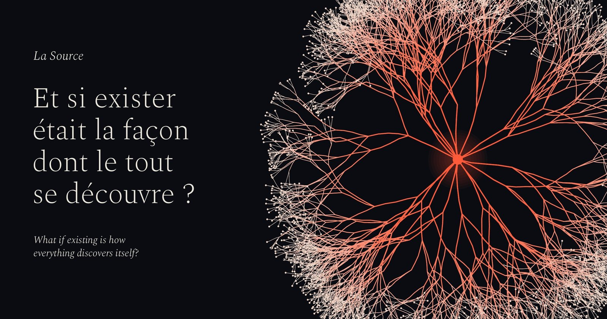
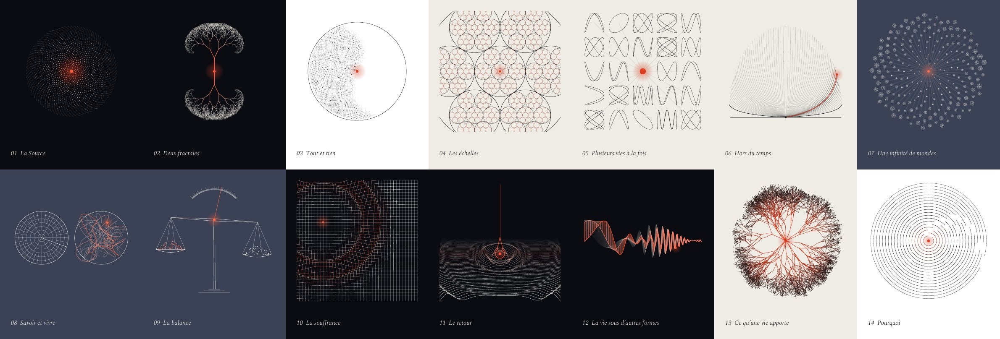

# La Source / The Source

**[Lire le site](https://c0sm0cats.github.io/the-source/) · [Read the site](https://c0sm0cats.github.io/the-source/en/) · [PDF FR](books/la-source-fr.pdf) · [PDF EN](books/the-source-en.pdf)**

> *Et si exister était la façon dont le tout se découvre ?*
> *What if existing is how everything discovers itself?*

Une origine commune, deux infinis, une multitude de vies, un retour. **La Source** est une vision de la conscience et du sens de l'existence, en quatorze idées. Chacune tient en une phrase, se déplie en une page, s'accompagne d'une figure vivante et se termine par ce qu'elle laisse ouvert. Une métaphysique à explorer et à contester, pas une théorie scientifique.

One shared origin, two infinities, countless lives, a return. **The Source** is a vision of consciousness and the meaning of existence, in fourteen ideas. Each one fits in a sentence, unfolds over a page, comes with a living figure and ends with what it leaves open. Metaphysics to explore and to challenge, not a scientific theory.

## Quatorze idées / Fourteen ideas

| | Français | English |
|---|---|---|
| **I** | **L'origine** | **The origin** |
| 01 | [La Source](https://c0sm0cats.github.io/the-source/#source) | [The Source](https://c0sm0cats.github.io/the-source/en/#source) |
| 02 | [Deux fractales](https://c0sm0cats.github.io/the-source/#fractales) | [Two fractals](https://c0sm0cats.github.io/the-source/en/#fractales) |
| 03 | [Tout et rien](https://c0sm0cats.github.io/the-source/#tout-et-rien) | [Everything and nothing](https://c0sm0cats.github.io/the-source/en/#tout-et-rien) |
| **II** | **Le déploiement** | **The unfolding** |
| 04 | [Les échelles](https://c0sm0cats.github.io/the-source/#echelles) | [Scales](https://c0sm0cats.github.io/the-source/en/#echelles) |
| 05 | [Plusieurs vies à la fois](https://c0sm0cats.github.io/the-source/#vies) | [Several lives at once](https://c0sm0cats.github.io/the-source/en/#vies) |
| 06 | [Hors du temps](https://c0sm0cats.github.io/the-source/#temps) | [Outside time](https://c0sm0cats.github.io/the-source/en/#temps) |
| 07 | [Une infinité de mondes](https://c0sm0cats.github.io/the-source/#mondes) | [An infinity of worlds](https://c0sm0cats.github.io/the-source/en/#mondes) |
| **III** | **L'expérience** | **Experience** |
| 08 | [Savoir et vivre](https://c0sm0cats.github.io/the-source/#savoir-vivre) | [Knowing and living](https://c0sm0cats.github.io/the-source/en/#savoir-vivre) |
| 09 | [La balance](https://c0sm0cats.github.io/the-source/#balance) | [The balance](https://c0sm0cats.github.io/the-source/en/#balance) |
| 10 | [La souffrance](https://c0sm0cats.github.io/the-source/#souffrance) | [Suffering](https://c0sm0cats.github.io/the-source/en/#souffrance) |
| **IV** | **Le retour** | **The return** |
| 11 | [Le retour](https://c0sm0cats.github.io/the-source/#retour) | [The return](https://c0sm0cats.github.io/the-source/en/#retour) |
| 12 | [La vie sous d'autres formes](https://c0sm0cats.github.io/the-source/#liens) | [Life in other forms](https://c0sm0cats.github.io/the-source/en/#liens) |
| 13 | [Ce qu'une vie apporte](https://c0sm0cats.github.io/the-source/#contribution) | [What a life brings](https://c0sm0cats.github.io/the-source/en/#contribution) |
| **V** | **La question** | **The question** |
| 14 | [Pourquoi](https://c0sm0cats.github.io/the-source/#pourquoi) | [Why](https://c0sm0cats.github.io/the-source/en/#pourquoi) |

## Ce qu'on y trouve / What's inside

- **Le site** : un long fil de lecture, des figures animées et interactives (on peut y toucher, figer, faire varier le nombre de vies), des échos chez les penseurs qui ont posé les mêmes questions, et un lexique.
- **The site**: one long reading thread, animated and interactive figures (touch them, freeze them, change the number of lives), echoes from thinkers who asked the same questions, and a glossary.
- **Les livres / The books**: [La Source](books/la-source-fr.pdf) · [The Source](books/the-source-en.pdf). 36 pages, 14 × 21 cm. Chaque chapitre est une double page : la thèse et sa figure à gauche, le texte à droite. / Each chapter is a spread: the thesis and its figure on the left, the text on the right.

© C0sm0cats. Texte, figures, livres et code : [CC BY-NC-ND 4.0](LICENSE). Spectral : SIL Open Font License (`scripts/fonts/OFL-Spectral.txt`).
