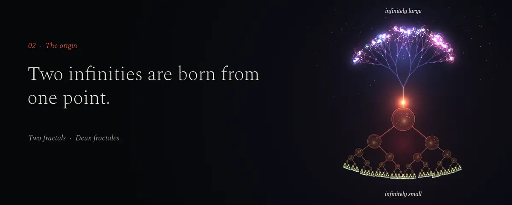

# The Source

**[Read online](https://c0sm0cats.github.io/the-source/en/) · [PDF](books/the-source-en.pdf)** — *En français : [lire le site](https://c0sm0cats.github.io/the-source/) · [PDF](books/la-source-fr.pdf)*

> *What if existing is how everything discovers itself?*

One shared origin, two infinities, countless lives, a return. **The Source** is a vision of consciousness and the meaning of existence, in thirty-six ideas. Each one fits in a sentence, unfolds over a few pages, comes with a living figure and ends with what it leaves open. Metaphysics to explore and to challenge, not a scientific theory.

## From the origin to the question

**I · The origin**  
[The Source](https://c0sm0cats.github.io/the-source/en/#source) · [Two fractals](https://c0sm0cats.github.io/the-source/en/#fractales) · [Everything and nothing](https://c0sm0cats.github.io/the-source/en/#tout-et-rien)

**II · The unfolding**  
[Birth](https://c0sm0cats.github.io/the-source/en/#naissance) · [The body](https://c0sm0cats.github.io/the-source/en/#corps) · [Childhood](https://c0sm0cats.github.io/the-source/en/#enfance) · [The self](https://c0sm0cats.github.io/the-source/en/#moi) · [Scales](https://c0sm0cats.github.io/the-source/en/#echelles) · [Other living beings](https://c0sm0cats.github.io/the-source/en/#autres-vivants) · [Several lives at once](https://c0sm0cats.github.io/the-source/en/#vies) · [Forgetting](https://c0sm0cats.github.io/the-source/en/#oubli) · [Outside time](https://c0sm0cats.github.io/the-source/en/#temps) · [An infinity of worlds](https://c0sm0cats.github.io/the-source/en/#mondes) · [The dream](https://c0sm0cats.github.io/the-source/en/#reve)

**III · Experience**  
[Knowing and living](https://c0sm0cats.github.io/the-source/en/#savoir-vivre) · [Freedom](https://c0sm0cats.github.io/the-source/en/#liberte) · [Play](https://c0sm0cats.github.io/the-source/en/#jeu) · [Fear](https://c0sm0cats.github.io/the-source/en/#peur) · [Love](https://c0sm0cats.github.io/the-source/en/#amour) · [Joy](https://c0sm0cats.github.io/the-source/en/#joie) · [Solitude](https://c0sm0cats.github.io/the-source/en/#solitude) · [Language](https://c0sm0cats.github.io/the-source/en/#langage) · [Beauty](https://c0sm0cats.github.io/the-source/en/#beaute) · [The balance](https://c0sm0cats.github.io/the-source/en/#balance) · [Suffering](https://c0sm0cats.github.io/the-source/en/#souffrance) · [Evil](https://c0sm0cats.github.io/the-source/en/#mal) · [Forgiveness](https://c0sm0cats.github.io/the-source/en/#pardon)

**IV · The return**  
[Death](https://c0sm0cats.github.io/the-source/en/#mort) · [The return](https://c0sm0cats.github.io/the-source/en/#retour) · [Life in other forms](https://c0sm0cats.github.io/the-source/en/#liens) · [What a life brings](https://c0sm0cats.github.io/the-source/en/#contribution) · [The ordinary](https://c0sm0cats.github.io/the-source/en/#ordinaire) · [Silence](https://c0sm0cats.github.io/the-source/en/#silence)

**V · The question**  
[The bearers](https://c0sm0cats.github.io/the-source/en/#passeurs) · [Doubt](https://c0sm0cats.github.io/the-source/en/#doute) · [Why](https://c0sm0cats.github.io/the-source/en/#pourquoi)

## What's inside

- **The site**: one long reading thread through five parts, under four nights. Every idea has a living figure made of light: hover it, touch it, open it full screen, freeze it, change the number of lives. Echoes from thinkers who asked the same questions, and a glossary. Arrow keys turn the chapters.
- **The books**: [The Source](books/the-source-en.pdf) · [La Source](books/la-source-fr.pdf). 148 pages, 14 × 21 cm. Each chapter opens on its thesis and figure, then unfolds over a few pages, with further figures and full-page plates.

© C0sm0cats. Text, figures, books and code: [CC BY-NC-ND 4.0](LICENSE). Spectral: SIL Open Font License (`scripts/fonts/OFL-Spectral.txt`).
